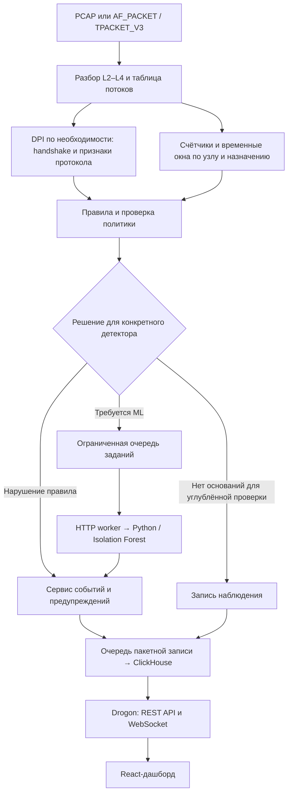

# Архитектура Militantyx

Статус: рабочий проект архитектуры. Документ описывает целевую систему,
а не уже реализованные возможности. Состояние реализации и порядок работ
приведены в [плане задач](TASK_BREAKDOWN.md).

## Назначение и границы

Militantyx анализирует копию трафика небольшой корпоративной сети и выявляет
признаки C2-взаимодействия через TLS, обход корпоративного DNS через DoH/DoT
и использование неразрешённых VPN-туннелей. Система исследует входящие
и исходящие соединения, доступные сенсору, без расшифровки содержимого.
Внутренние соединения доступны только при зеркалировании соответствующего
сегмента; сенсор на шлюзе не видит автоматически всю локальную сеть.

DoH, DoT и VPN являются нарушением только относительно заданной политики.
Подозрение на C2 не считается доказанным заражением. По сетевым метаданным
нельзя гарантированно отличить разрешённый сеанс удалённого администрирования
от злоупотребления тем же приложением.

Основной объём: Ethernet, IPv4, TCP/UDP, TLS 1.2/1.3 и выбранные профили
VPN-протоколов. OpenVPN и WireGuard рассматриваются как кандидаты для двух
проверяемых детекторов. QUIC и произвольные обфусцированные туннели остаются
за пределами обязательного результата.

Режим работы пассивный: обнаружение создаёт запись и уведомление.
Блокировка пакетов, управление firewall и TLS-перехват не входят в проект.

## Общая схема

Пропуск ML относится к определённой проверке, а не к вечному доверию потоку
или адресу. Например, разрешённый DNS-сервис не освобождает узел от проверки
аномального поведения. Базовая статистика поддерживаемых потоков продолжает
обновляться независимо от решения правил.

## Компоненты и границы выполнения

Для первой версии предусмотрены один C++-процесс сенсора и backend,
отдельный Python-сервис, ClickHouse и frontend. В C++ обработка пакетов,
HTTP-взаимодействие с ML, запись в БД и обслуживание веб-запросов выполняются
в отдельных контурах. Сетевой ввод-вывод к ML и БД не выполняется в обработчике
пакета; общение контуров идёт через ограниченные очереди.

| Модуль | Ответственность | Результат |
|---|---|---|
| Источник пакетов | PCAP или кольцевой буфер Linux; учёт потерь захвата | Пакет и временная метка |
| L2–L4 parser | Проверка границ, адреса, порты, TCP-флаги | Заголовки или причина пропуска |
| Flow manager | Двунаправленный ключ, жизненный цикл, счётчики | Состояние потока и снимки |
| DPI | Ограниченная сборка TCP-данных и разбор поддерживаемых протоколов | Метаданные и статус распознавания |
| Агрегатор окон | История соединений и обмена по узлу и назначению | Признаки за временное окно |
| Правила и маршрутизация | Политика, наблюдаемые признаки, необходимость ML | Решение и его основание |
| ML dispatcher | Пакетные запросы, тайм-ауты, ограниченные повторы | Результат или статус недоступности |
| Python ML | Валидация признаков, применение сохранённой модели | Оценка аномальности |
| Сервис событий | Объединение повторов, учёт источника и ревизий | Предупреждение или наблюдение |
| Хранилище и API | Пакетная запись, запросы истории, WebSocket | Данные для оператора |

Сначала реализуется один обработчик потоков. При необходимости масштабирования
потоки распределяются между обработчиками по симметричному ключу: оба направления
соединения должны попадать одному владельцу. Многопоточность добавляется после
измерения исходного варианта.

## Обработка пакетов и состояние потока

Для отнесения пакета к потоку необходимо прочитать минимальные заголовки.
Дорогой разбор прикладного протокола не повторяется на всём содержимом потока:
он вызывается, пока нужны данные для распознавания или конкретного детектора.

DPI хранит состояние разбора и ограничения по времени, числу пакетов и объёму
буфера. TLS ClientHello может занимать несколько TCP-сегментов и TLS-записей,
поэтому одного первого пакета недостаточно. Повторы, перестановка сегментов
и незавершённый handshake учитываются явно. При исчерпании бюджета результат
помечается как неполный, а не как безопасный.

Для первой версии IP-фрагменты и неподдерживаемые протоколы явно учитываются
как неразобранные; порты из фрагмента без транспортного заголовка не извлекаются.
Поддержка фрагментации может быть добавлена отдельной задачей после оценки
потерь покрытия.

Статистика содержит пакеты и байты по направлениям, времена начала и последней
активности, интервалы и доступные TCP-флаги. Семантика байтов фиксируется в
контракте: IP-байты учитываются отдельно от полезной нагрузки. RST, завершение
обоих направлений TCP и тайм-ауты обрабатываются раздельно; первый FIN сам по
себе не означает завершения обоих направлений.

Долгоживущий поток выдаёт периодические снимки до завершения. Снимки имеют
номер ревизии и признак финальной записи; накопительные счётчики разных
ревизий нельзя суммировать как независимые потоки.

## DPI и детекторы

### C2 через TLS

Из ClientHello извлекаются доступные поля: версия, наборы шифров, расширения,
предлагаемый ALPN, SNI и fingerprint выбранного формата. Отсутствующие поля
маркируются отдельно. Сертификаты TLS 1.3 недоступны пассивному сенсору,
а ECH ограничивает видимость внутреннего ClientHello.

Для оценки beaconing используются несколько соединений между узлом
и назначением: интервалы, их разброс, объёмы и направления обмена.
Исходный эфемерный порт не должен разделять такую историю на независимые
наблюдения. Для долгоживущих каналов исследуются интервалы активности внутри
потока. Редкий fingerprint или периодичность по отдельности не подтверждают C2.

### Обход DNS-политики

Правила учитывают разрешённые резолверы, наблюдаемые имена и адреса,
доступные признаки протокола и поведение. Совпадение только по порту или
общему IP облачной платформы недостаточно для уверенного определения DoH.
Обращение к неизвестному сервису может остаться неопределённым.

Проверка относится к неразрешённому использованию DoH/DoT, а не к запрету
шифрованного DNS как технологии.

### Неразрешённые VPN-туннели

Детекторы реализуются под зафиксированные версии и конфигурации протоколов.
Сначала на стенде проверяется распознаваемость обычных OpenVPN и WireGuard,
затем утверждается обязательный набор. Использование нестандартного порта
входит в тесты, произвольная обфускация — нет.

AnyDesk и другие средства удалённого доступа используются в проверках ложных
тревог. Поддержка их классификации является отдельной возможностью и не
подразумевается наличием VPN-детектора.

## Маршрутизация и ML

Для каждой проверки возможны: нарушение правила, отсутствие оснований для ML,
необходимость ML и недостаточность данных. Последнее состояние не приравнивается
к норме. Маршрутизатор сохраняет версию правил и причину выбранного пути.

В рабочем режиме в ML поступают выбранные неопределённые случаи. Для контроля
ошибок маршрутизации отдельно предусмотрена воспроизводимая выборка пропущенных
наблюдений; её объём задаётся конфигурацией. В экспериментах действует режим
оценки всех релевантных наблюдений для сравнения с каскадом.

Базовая модель — Isolation Forest на проверенном нормальном трафике.
Векторы признаков потоков и временных окон имеют разные схемы; при использовании
обоих видов наблюдений для них обучаются отдельные экземпляры модели.
Версия схемы, преобразование признаков, версия модели и порог сохраняются вместе.
Порог подбирается на валидационной выборке. Автоматическое дообучение на
текущем трафике в первую версию не входит.

Модель возвращает оценку аномальности, не вероятность атаки и не подтверждение
заражения. Категория предупреждения определяется детектором и наблюдаемыми
основаниями. Предупреждение показывает эти основания, порог и оценку;
объяснение не генерируется LLM.

## Черновые контракты

| Запись | Основные поля |
|---|---|
| FlowRecord | schema_version, sensor_id, capture_id, flow_id, revision, is_final, tuple, initiator, start/end, counters, protocol_metadata, parse_status |
| WindowRecord | schema_version, window_id, revision, host, peer, start/end, connection_count, interval/volume_features, coverage |
| DetectionEvent | event_id, detector_id/version, policy_version, flow/window references, route, category, evidence |
| AnalysisJob | job_id, observation_id/revision, feature_schema_version, numeric_features, missing_flags, deadline |
| AnalysisResult | job_id, observation_revision, model_version, anomaly_score, threshold, status |
| Alert | alert_id, category, severity, source, evidence, observation references, analysis_status |
| SensorHealth | capture/processing losses, queue occupancy/drops, parse coverage, memory, processing/inference/export latency |

Контракты являются эскизом; точные типы, единицы измерения и JSON-примеры
фиксируются отдельной задачей до интеграции компонентов. Ключ потока не заменяет
уникальный flow_id: одна и та же комбинация адресов и портов может использоваться
повторно.

Повторы запросов используют тот же job_id. Сервис событий проверяет ревизии
и не создаёт второй алерт при повторной доставке результата.
Источник решения хранится как rule, ml или hybrid, состояние проверки —
отдельным полем. Для ML-результатов и правил используется общий сервис событий;
два отдельных API для «подтверждённой угрозы» и «LLM-угрозы» не требуются.

## Очереди, хранение и отказоустойчивость

Очереди ML и записи в ClickHouse независимы и ограничены по числу элементов
и памяти. По заполнению ML-очереди захват не ждёт освобождения места: задание
получает статус пропуска из-за перегрузки и учитывается в метриках.
Тайм-аут, ошибка модели и пропуск не превращаются в отрицательный вердикт.
Правила продолжают работать при остановленном Python-сервисе.

Внутрипроцессные очереди первой версии не гарантируют сохранность при аварии.
Отказ ClickHouse допускает только ограниченный буфер и повторы; переполнение
сопровождается счётчиком потерь экспорта. Отдельно измеряются потери захвата,
обработки, заданий ML и сохранения данных.

ClickHouse хранит версии снимков потоков, окон, событий и результатов ML.
API выбирает актуальную ревизию, чтобы снимки не увеличивали число потоков
и объём трафика повторно. WebSocket-уведомления публикуются после успешной записи;
после переподключения frontend восстанавливает состояние через REST.
Недоступность БД отображается как задержка или потеря данных.

## Размещение в монорепозитории

Существующие каталоги сохраняются. Предлагаемые области ответственности:

- sources/core: capture, parsing, flows, dpi, detection, aggregation,
  pipeline, storage, api и logging;
- sources/ml: подготовка признаков, offline-обучение, модели, HTTP-инференс
  и проверки качества;
- sources/dashboard: обзор, потоки, предупреждения и состояние сенсора;
- docs: границы проекта, архитектура, контракты и план испытаний.

Подкаталоги создаются по мере реализации, а не как пустой каркас заранее.

## Основания решений

| Решение | Рассмотренная альтернатива | Следствие |
|---|---|---|
| Выборочный DPI с бюджетом | Полный разбор всего содержимого | Снижение затрат требует измерять неполные распознавания |
| Правила перед ML | Инференс всех потоков | Меньше заданий, но ошибки отбора требуют отдельной оценки |
| Асинхронная очередь | Ожидание Python в обработчике | Независимость захвата, но отложенный результат и возможная перегрузка |
| Isolation Forest | LLM-интерпретация каждого спорного случая | Проверяемый числовой baseline; тип атаки определяется вне модели |
| Один C++-процесс с изолированным I/O | Разделение каждого модуля на сервис | Проще первая интеграция; CPU и память компонентов всё ещё общие |
| Пассивный сенсор | Inline-блокировка | Проверка обнаружения без управления прохождением трафика |

Это рабочие решения текущего проекта. Само сочетание DPI, ML и дашборда
не заявляется научной новизной. Исследуется соотношение затрат и качества
при выборочном DPI и каскадной маршрутизации; преимущество подтверждается
только экспериментами.
