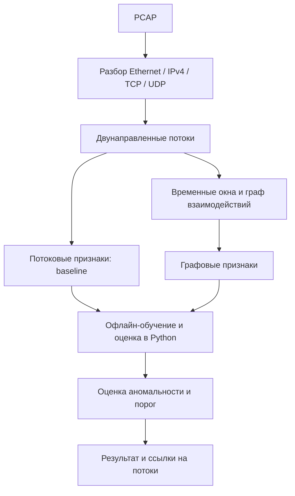

# Архитектура Militantyx

Документ описывает планируемый офлайн-прототип. Сейчас работают
журналирование, сборка и проверки кода.

## Путь данных

Сначала результат сохраняется в файл. ClickHouse, HTTP-инференс и интерфейс
подключаются после офлайн-эксперимента. Запросы к внешним сервисам
будут выполняться вне обработчика пакета, через очереди с ограниченным размером.

## Ответственность компонентов

| Компонент | Назначение | Состояние |
|---|---|---|
| C++ core | PCAP, разбор, потоки, граф, экспорт признаков | Есть только логирование и сборка |
| Python ML | Подготовка выборок, обучение, порог, оценка | Не реализован |
| Dashboard | Просмотр аномальных окон и связанных потоков | Не реализован |

## Рабочий вариант графа

Для первого эксперимента предлагается граф за фиксированное временное окно:
вершины - наблюдаемые сетевые узлы, рёбра - агрегированные направленные
взаимодействия между ними. Двунаправленный поток остаётся исходной записью;
направление задаётся по инициатору соединения, если его удалось определить.
На рёбрах сохраняются число потоков, объёмы по направлениям, время и интервалы.
Признаки узла вычисляются по его локальному окружению.

Этот вариант предложен для первого эксперимента. В HyperVision короткие
и длинные потоки представлены по-разному. Перед реализацией нужно
описать точные правила агрегации и сравнить варианты на данных.

Возможные признаки: число соседей, доли входящих и исходящих связей,
повторяемость обращений, распределение объёмов по соседям, связность локального
окружения. Список и определения фиксируются до итоговых испытаний.
IP-адреса не подаются в модель как произвольные числа. Эфемерный исходный
порт не разделяет историю обращений к одному назначению.

Размер окна и границы агрегации влияют на результат. В первой версии окна
не перекрываются; правило привязки потока к окну и расчёт приращений счётчиков описываются
вместе с реализацией. Связанные окна одного захвата не распределяются случайно
между train и test.

## Потоки и качество наблюдения

Разбор проверяет границы буфера. Учитываются временные метки, число пакетов и байтов по
направлениям. Для долгоживущего потока нужны снимки с ревизией и признаком
завершения; накопительные счётчики нельзя суммировать между ревизиями.
FIN одного направления не означает завершение обоих направлений.

Неподдерживаемые протоколы, IP-фрагменты и обрезанные пакеты учитываются
отдельно. Неполные данные нельзя автоматически считать нормальным трафиком.
Сенсор видит только трафик, попавший в захват: наблюдение шлюза не гарантирует
видимость всех взаимодействий внутри сети.

## Детектор и C2

Isolation Forest из прежнего плана остаётся кандидатом для baseline на
числовых признаках. Окончательный метод для графа пока не выбран.
Все варианты проверяются на одной тестовой выборке; пороги выбираются
на валидационной.
Вместе с моделью сохраняются схема признаков, преобразования, настройки
окна и seed генератора случайных чисел.

C2-beaconing входит в набор проверочных сценариев. Графовый детектор
выделяет аномальную структуру; для метки C2 нужны дополнительные основания.
TLS ClientHello можно использовать в дополнительном эксперименте, с учётом
неполного handshake и ограничений ECH. Расшифровка содержимого не требуется.

## Записи для офлайн-обмена

| Запись | Необходимые поля |
|---|---|
| FlowRecord | capture_id, flow_id, tuple, initiator_status, start/end, counters, parse_status |
| GraphWindow | schema_version, capture_id, window_id, start/end, nodes, edges, flow_refs, coverage |
| FeatureRecord | schema_version, observation_id, feature_names, values, missing_flags |
| AnalysisResult | observation_id, model_version, anomaly_score, threshold, status, evidence_refs |
| ExperimentManifest | источники, хеши, разделение данных, конфигурации, версии, seed |

Это предварительные форматы записей. Единицы измерения, типы и примеры
нужно описать до интеграции. Содержимое пакетов в ML не передаётся. Ошибки извлечения и оценки записываются отдельно
и не считаются отрицательными результатами детектора.

## Ограничения

Первая версия: PCAP, IPv4, TCP/UDP, офлайн-обработка. NAT, общие облачные
адреса и частичная видимость могут искажать граф. FlowPrint исследует
мобильные приложения; применимость временных корреляций к рабочим станциям
проверяется отдельно. [Протокол исследования](RESEARCH_PROTOCOL.md) задаёт
порядок проверки и ограничения выводов.
